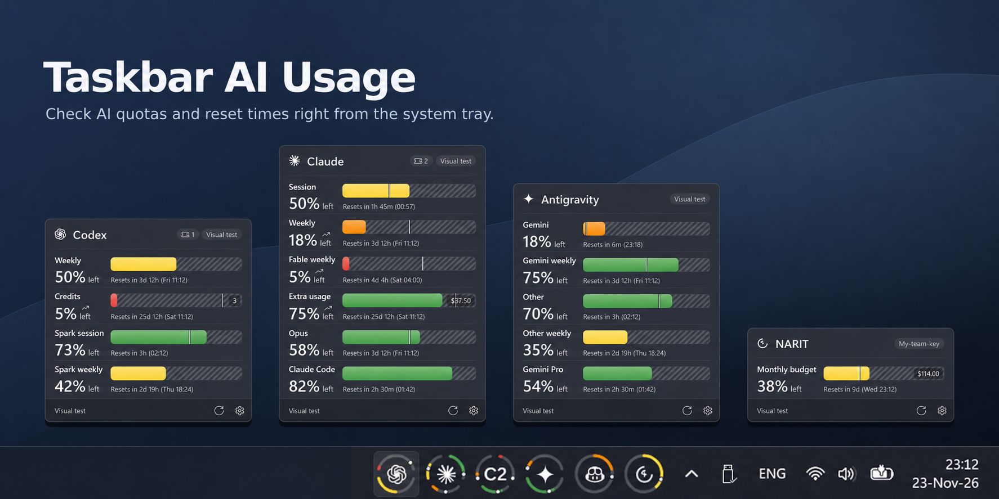

# Taskbar AI Usage

A fork of [Taskbar AI Usage](https://github.com/Sof2245/taskbar-ai-usage) by Sof2245 (MIT), a
Windhawk mod that puts the quota left on each AI account next to the Windows 11 clock. This fork adds
the NARIT provider, whose ring is the API key's monthly budget.

## Install

1. Download `windhawk-taskbar-ai-narit.wh.cpp`, then in Windhawk use **Create new mod**, paste the
   file, **Compile** and **Install**. There is no Mods entry to search for.
2. Open **Settings → Accounts → +**, choose provider **NARIT**, **Sign in** and paste the API key.

## Credits

The projects this mod is built from, with their copyright and licence, are in [NOTICE.md](NOTICE.md).

## Licence

MIT. The copyright line and the licence text are in [LICENSE](LICENSE).
